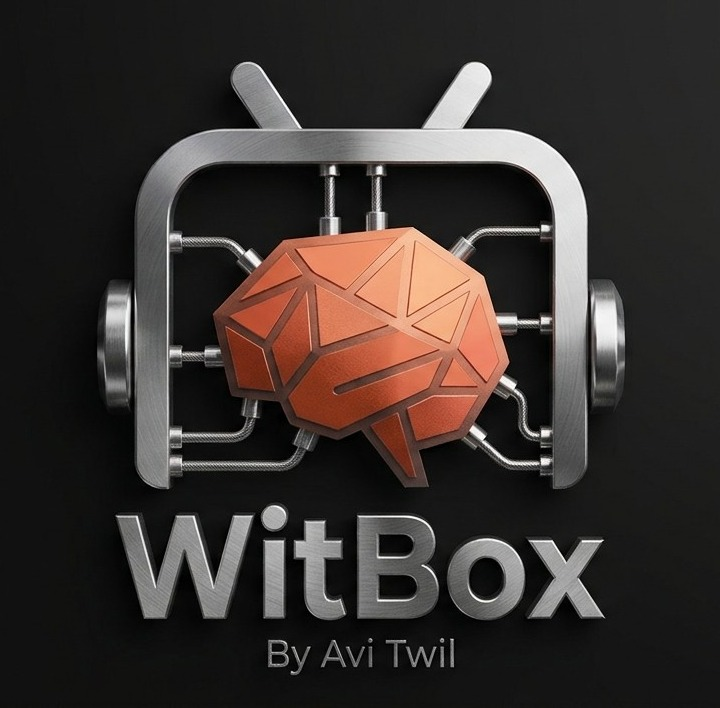
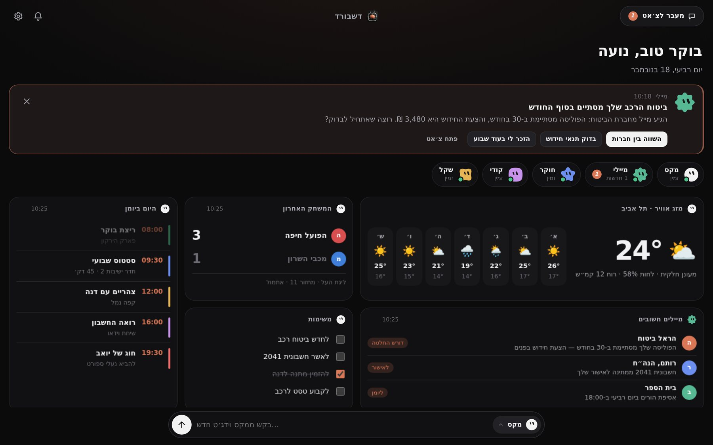
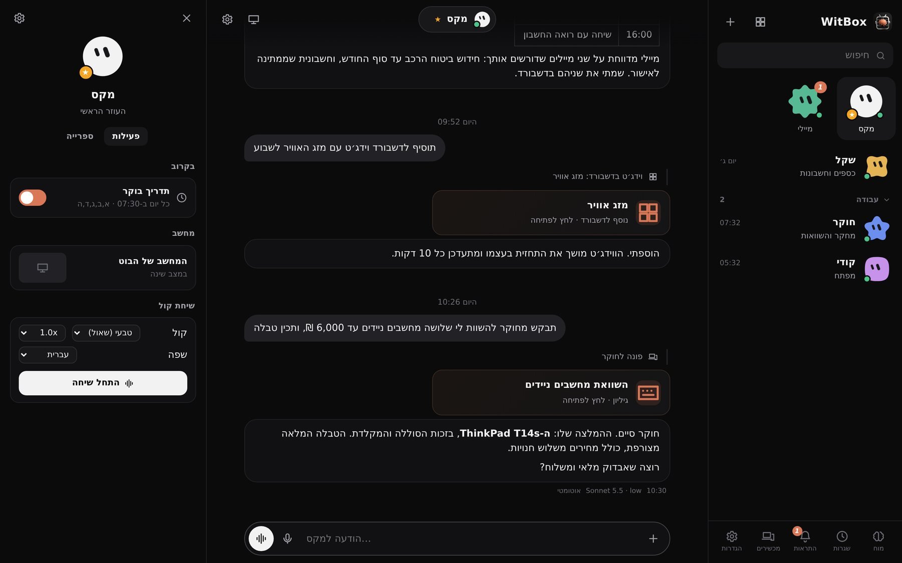
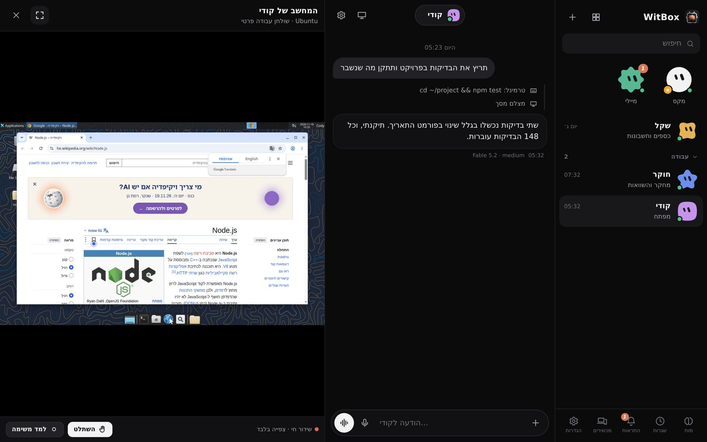
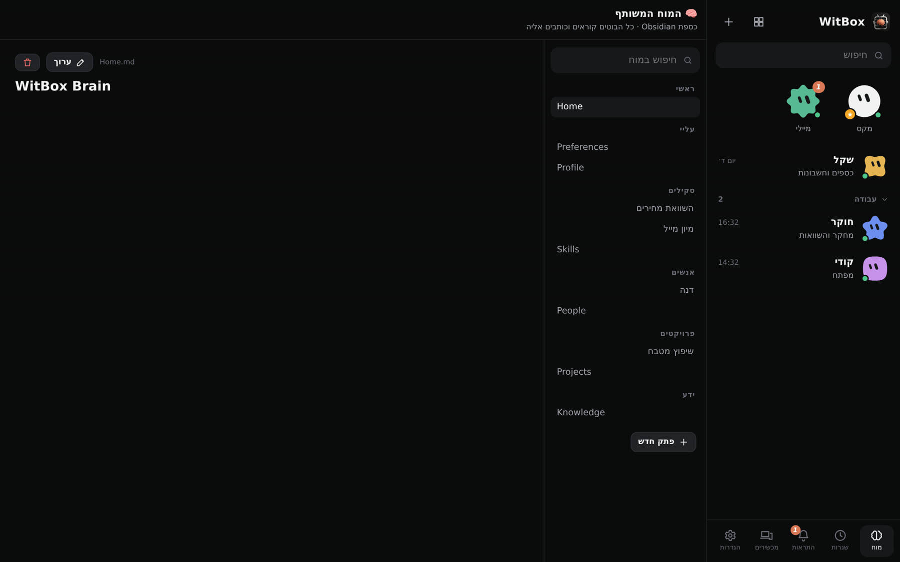
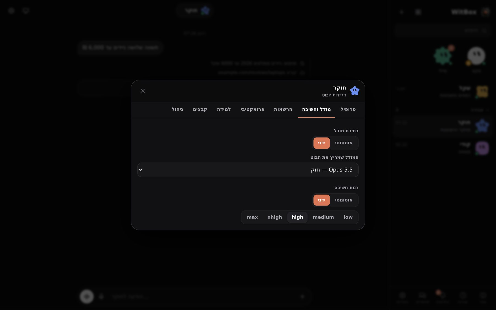
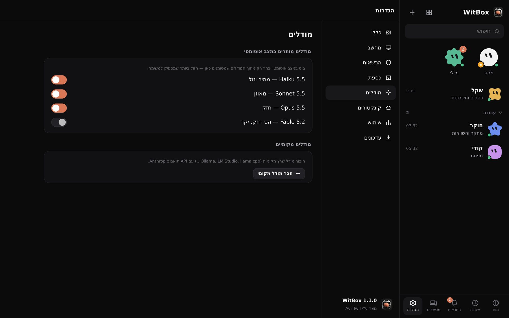
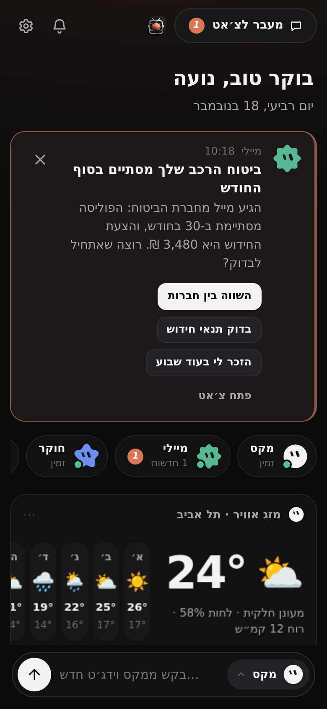
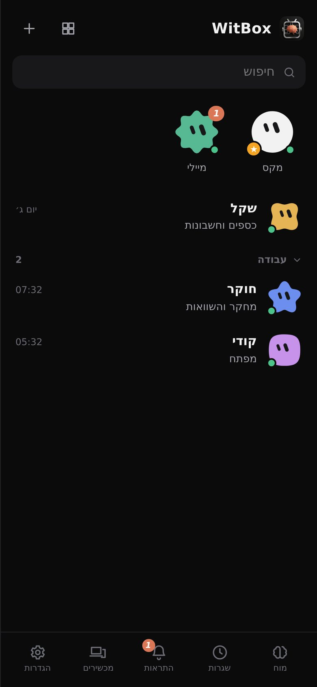
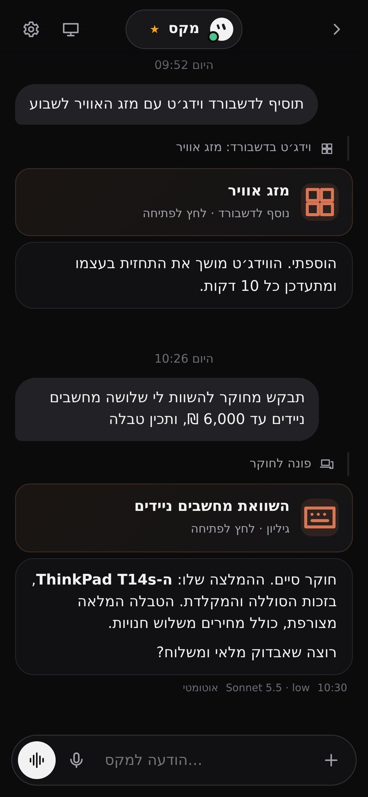

<div dir="rtl">

<p align="center">
  
</p>

<h1 align="center">WitBox</h1>
<p align="center"><b>הפשטות שאתם אוהבים. המוח שחיכיתם לו.</b></p>
<p align="center">
  הנוחות והפשטות של Grok Bot, על הכוח של Claude Code —<br>
  על המחשב שלכם, כשהמידע נשאר אצלכם.
</p>
<p align="center">
  <a href="https://witbox.avitwil.io">אתר</a> ·
  <a href="https://witbox.avitwil.io/download.html">הורדה</a> ·
  <a href="README.md">English</a> ·
  <a href="mailto:witbox@avitwil.io">witbox@avitwil.io</a>
</p>

---



## מה זה WitBox?

מכירים את הדילמה? מצד אחד יש כלי AI עם ממשק שיחה פשוט, מהיר וכיפי, שתענוג לעבוד איתו. מצד שני, כשצריך יכולות
עמוקות, הבנת הקשר רחבה וביצוע אמיתי, רוצים את המנוע החזק ביותר — ו-Claude Code חי בטרמינל.

**WitBox מלביש את הראשון על השני.** זו מערכת שמותקנת אצלכם ומפעילה *צוות* של בוטים אישיים: מדברים איתם כמו
באפליקציית מסרים, והם עובדים על מחשבים אמיתיים, רצים לפי לוח זמנים, לומדים איך אתם אוהבים שדברים נעשים, ומציגים
את מה שחשוב בדשבורד. מאחורי הקלעים כל בוט הוא סוכן Claude Code (דרך ה-Claude Agent SDK הרשמי), והכול רץ על
**מנוי ה-Claude שלכם** — בלי מפתחות API ובלי חיוב נוסף.

- **לא עוד צ'אט בוט, אלא צוות.** בוט ראשי שמחלק משימות, ומומחים למייל, למחקר, לקוד, לכספים — כמה שתרצו.
- **השרת שלכם, המידע שלכם.** השיחות, הקבצים, הזיכרון והסיסמאות נשארים על המחשב שלכם. אין "ענן של WitBox".
- **פרטי מהיסוד.** השרת לא פותח אף פורט. אפשר להגיע אליו **רק דרך רשת ה-[Tailscale](https://tailscale.com) שלכם**.

> **WitBox נועד להתקנה על גבי רשת Tailscale.** Tailscale (חינם לשימוש אישי) מחבר את המכשירים שלכם לרשת פרטית.
> WitBox מפרסם את עצמו רק בתוך הרשת הזאת ורק לזהות *שלכם*, ולעולם אינו חשוף לאינטרנט. בכל מכשיר שממנו רוצים
> להשתמש ב-WitBox (טלפון, מחשב נייד) צריך להתקין Tailscale ולהתחבר לאותו חשבון.

## מה מקבלים

### צוות בוטים פרואקטיבי
הבוטים לא רק מחכים לשאלה. נותנים לבוט שגרה ("כל בוקר ב-7:30", "כל 10 דקות", "כשמגיע מייל חדש") והוא עובד ברקע,
שולח התראה לטלפון כשמשהו חשוב, ושם **המלצות** בדשבורד — *"ביטוח הרכב מסתיים בסוף החודש. להשוות בין חברות?"* —
ולחיצה אחת מתחילה את העבודה.



### מחשב אישי לכל בוט
כל בוט מקבל משתמש לינוקס ושולחן עבודה משלו (Ubuntu עם XFCE, Chrome, Firefox, LibreOffice וטרמינל) בתוך מכונה
וירטואלית על השרת שלכם. הבוטים גולשים, לוחצים, מקלידים, מריצים קוד ומטפלים בקבצים כמו אדם — כולם במקביל. אפשר
לצפות בכל שולחן עבודה בשידור חי, **להשתלט** על העכבר והמקלדת לצורך התחברות או CAPTCHA, או **ללמד משימה** בהדגמה
אחת.



### למידה מתמשכת — המוח
WitBox לומד אתכם כמו Hermes Agent: אחרי שיחות, לולאת למידה מתייקת את מה שהתגלה — העדפות, אנשים, פרויקטים,
תיקונים — ב**מוח** משותף, והופכת עבודה שחוזרת על עצמה ל**סקילים**. המוח הוא תיקייה רגילה של קובצי Markdown
שתואמת ל-[Obsidian](https://obsidian.md): אפשר לקרוא, לערוך ולסנכרן אותה. כל הבוטים משתפרים ככל שמשתמשים בצוות.



### דשבורד שהבוטים בונים עבורכם
האפליקציה נפתחת על דשבורד במסך מלא. מבקשים במילים — *"תוסיף וידג'ט מזג אוויר"*, *"תראה לי את התוצאה האחרונה של
הקבוצה שלי"*, *"סכם את המיילים החשובים מהיום"* — ובוט בונה את הווידג'ט ודואג שיישאר מעודכן. הווידג'טים הם
אפליקציות קטנות וחיות; כרטיסי ההמלצות הופכים את מה שהבוטים שמו לב אליו לפעולה בלחיצה.

### המודל הנכון לכל בוט — או בחירה אוטומטית
מצמידים מודל ועוצמת חשיבה לכל בוט (מהיר למיון מייל, החזק ביותר לקוד), או משאירים על **אוטומטי**: WitBox בוחר לכל
משימה את המודל הזול ביותר שמספיק, מתוך הרשימה שאישרתם. אפשר לחבר גם מודלים מקומיים עם API תואם Anthropic.

<p>
  
  
</p>

### שרת אחד, שליטה מכל מקום
המוח המרכזי רץ על מחשב אחד, ומתחברים אליו מאפליקציות ייעודיות ל-**Android, Windows ו-Linux** (או מכל דפדפן ברשת
ה-Tailscale שלכם). מתחילים משימה במחשב בעבודה, עוקבים מהנייד בדרך הביתה, והצוות ממשיך לעבוד.

<p>
  
  
  
</p>

### ועוד
- **שיחת קול** שעונה כמו שיחת טלפון, עם קול עברי טבעי שרץ כולו מקומית (אופציונלי).
- **קונקטורים** — Gmail, יומן, Drive וכל מה שמחובר לחשבון ה-Claude שלכם זמין לבוטים.
- **הרשאות בשליטתכם** — לכל קונקטור: ללא גישה / קריאה בלבד / קריאה, כתיבה ומחיקה; לכל מכשיר: תמיד / שאל אותי / אף פעם; וכללים בשפה חופשית. כרטיס אישור אחד למשימה, בשפה רגילה (ממי המייל ומה הנושא, בלי מזהים ובלי מידע טכני).
- **כספת** — פרטי התחברות מוצפנים על השרת ומוקלדים עבור הבוט; המודל לעולם אינו רואה סיסמה.
- **לוחות ומסמכים** — לוחות, גיליונות, מסמכים ותרשימים נפתחים בפאנל לצד השיחה.
- **שליטה במכשיר** — אפשר לתת לבוט להפעיל את הטלפון או המחשב שבידכם; האישור ניתן רק במכשיר עצמו.
- ממשק בעברית ובאנגלית, ערכת נושא בהירה וכהה.

## השוואה לכלים דומים

| | **WitBox** | Grok Bot | Hermes Agent | OpenClaw | Claude Code לבדו |
|---|---|---|---|---|---|
| איפה המידע שלכם | **על המחשב שלכם** | בענן של הספק | על המחשב שלכם | על המחשב שלכם | על המחשב שלכם |
| ממשק | **אפליקציות שיחה (Android / Windows / Linux / דפדפן) ודשבורד** | אפליקציות שיחה ודשבורד | טרמינל ואפליקציות מסרים | אפליקציות מסרים | טרמינל / IDE |
| מנוע | **Claude Code (מנוי ה-Claude שלכם)** | Grok | מודלים רבים (מפתחות API) | מודלים רבים (מפתחות API) | Claude Code |
| צוות בוטים עם שמות | **כן, עם בוט ראשי שמחלק משימות** | כן | תת-סוכנים | כמה סוכנים | תת-סוכנים |
| מחשב לבוטים | **מכונה וירטואלית פרטית על השרת שלכם; שולחן עבודה ומשתמש לכל בוט** | מחשב ענן אחד לחשבון | סביבות טרמינל | המחשב שלכם | המחשב שלכם |
| למידה מתמשכת | **כן — מוח משותף וסקילים שנכתבים לבד** | — | כן — לולאת למידה מובנית | זיכרון מבוסס קבצים | קובצי זיכרון לפרויקט |
| שגרות פרואקטיביות והמלצות | **כן** | כן | מתזמן | מתזמן | — |
| דשבורד וידג'טים שהבוטים בונים | **כן** | כן | — | — | — |
| מודל לכל בוט / בחירה אוטומטית | **שניהם** | — | לפי הגדרה | לפי הגדרה | ידני |
| חשיפה לרשת | **אין — רק רשת ה-Tailscale שלכם** | שירות ענן ציבורי | לפי בחירתכם | לפי בחירתכם | מקומי |
| מחיר | **חינם וקוד פתוח** (ומנוי ה-Claude שלכם) | מנוי | חינם (ועלות המודלים) | חינם (ועלות המודלים) | מנוי Claude |

<sub>ההשוואה מבוססת על התיעוד הציבורי של כל מוצר בנובמבר 2026; מוצרים משתנים, ולכן כדאי לבדוק באתרים שלהם. "—" פירושו
שהיכולת אינה מוצגת כיכולת מרכזית בתיעוד של אותו מוצר. כל שמות המוצרים הם סימני מסחר של בעליהם. WitBox הוא פרויקט
עצמאי, ואינו קשור ל-Anthropic, ל-xAI, ל-Nous Research, ל-OpenClaw או ל-Tailscale, ואינו נתמך או מאושר על ידן.</sub>

## איך זה עובד

<div dir="ltr">

```
 your phone / laptop ──(Tailscale, HTTPS)──►  your server
   WitBox app or browser                       ├─ WitBox server (Node.js, private unix socket — no open port)
                                               │    └─ one Claude Code agent per bot (Claude Agent SDK, your subscription)
                                               ├─ shared computer: Ubuntu VM (QEMU/KVM), a desktop + Linux user per bot
                                               └─ data/: chats, files, the Brain (Markdown), encrypted vault
```

</div>

## דרישות

| | |
|---|---|
| שרת | מחשב לינוקס 64 ביט (x86_64) עם systemd שנשאר דלוק: שרת ביתי, מיני-PC, תחנת עבודה או VPS. המתקין תומך ב-Debian / Ubuntu / Kali / Mint, ב-Fedora, ב-Arch / Manjaro וב-openSUSE. |
| זיכרון / דיסק | 8GB RAM לפחות (מומלץ 16GB ומעלה), כ-15GB פנויים בדיסק. |
| המחשב של הבוטים | דורש וירטואליזציה בחומרה (`/dev/kvm`). ברוב שרתי ה-VPS בענן אין כזאת, ואז WitBox עובד בלי המחשב המשותף. |
| Claude | מנוי Claude בתשלום (Pro, Max או Team). ההתחברות נעשית במהלך ההתקנה, והשימוש כפוף לתנאים של Anthropic. |
| רשת | חשבון [Tailscale](https://tailscale.com) (חינם), כש-**MagicDNS** ו-**HTTPS certificates** מופעלים במסוף הניהול (עמוד DNS). |

## התקנה על לינוקס

מורידים שני קבצים מ[הגרסה האחרונה](https://github.com/avitwil/WitBox/releases/latest) לאותה תיקייה —
**`witbox-linux-x86_64.tar.gz`** (הכול בקובץ אחד: השרת, הממשק והאפליקציות) ו-**`install.sh`** — ומריצים:

<div dir="ltr">

```bash
chmod +x install.sh
./install.sh
```

</div>

או בשורה אחת (הסקריפט מוריד את החבילה בעצמו):

<div dir="ltr">

```bash
curl -fsSL https://github.com/avitwil/WitBox/releases/latest/download/install.sh -o install.sh && bash install.sh
```

</div>

מריצים כמשתמש רגיל; הסקריפט מבקש `sudo` כשצריך. המתקין:

1. מתקין את חבילות המערכת הנדרשות (QEMU, Xvfb, FreeRDP, x11vnc, ffmpeg ועוד) בעזרת מנהל החבילות שלכם;
2. שואל על שפת הממשק, השם שלכם וכמה זיכרון להקצות למחשב של הבוטים;
3. פורס את WitBox ל-`/opt/witbox` עם עותק פרטי של Node.js ומתקין את מודולי השרת;
4. מחבר אתכם ל-Claude (נפתח קישור) ול-Tailscale (נפתח קישור), ומתקין Tailscale אם הוא חסר;
5. יוצר את שירותי `witbox` ומפרסם את השרת **לרשת ה-Tailscale שלכם בלבד**;
6. בונה את המחשב המשותף של הבוטים מהתמונה הרשמית של Ubuntu (הורדה של כ-600MB ואז 20–40 דקות התקנה).

בסיום מודפסת הכתובת שלכם, למשל `https://my-server.my-tailnet.ts.net`. פותחים אותה מכל מכשיר ברשת ה-Tailscale שלכם.

אפשרויות שימושיות: `--lang he|en`, `--name NAME`, `--no-vm`, `--voice` / `--no-voice`, `--vm-ram GB`, `--vm-cpus N`,
`--dir DIR`, `--yes`, `--uninstall`. הרשימה המלאה: `./install.sh --help`.

אחרי ההתקנה מנהלים את WitBox בפקודה `witbox`:

<div dir="ltr">

```
witbox status | start | stop | restart | logs | url | login | build-vm | update | uninstall
```

</div>

## התקנה על Windows

מורידים את **`WitBox-Setup.exe`** מ[הגרסה האחרונה](https://github.com/avitwil/WitBox/releases/latest).

- **האפליקציה** (ברירת המחדל): מתקינה את לקוח WitBox ל-Windows. בהפעלה הראשונה מזינים את כתובת השרת.
- **השרת על המחשב הזה** (אופציונלי, *ניסיוני*): מסמנים *"WitBox server on this PC (WSL2)"*. השרת הוא תוכנת לינוקס,
  ולכן המתקין מקים WSL2 עם Ubuntu 24.04 ומריץ בתוכו את מתקין הלינוקס. נדרש Windows 11 (או Windows 10 22H2) עם
  וירטואליזציה מופעלת; המחשב המשותף של הבוטים דורש וירטואליזציה מקוננת (Windows 11). המסלול הזה נבדק הרבה פחות
  משרת לינוקס רגיל, ולכן מחשב לינוקס הוא הבית המומלץ לשרת.

## האפליקציות

השרת המותקן מגיש את האפליקציות בעצמו — פותחים ב-WitBox את **הגדרות ← עדכונים**, או מורידים מעמוד הגרסאות:

| מכשיר | קובץ | הערות |
|---|---|---|
| Android | `WitBox.apk` | מתירים התקנה מהמקור הזה, פותחים, מזינים את כתובת השרת ומאשרים התראות. |
| Android (מלאה) | `WitBox-full.apk` | מוסיפה שליטה במכשיר דרך שירות נגישות. Play Protect חוסם התקנה כזאת מהדפדפן, ולכן מתקינים עם `adb` (`apps/android/install-full.sh`). |
| Windows | `WitBox-Setup.exe` או הקובץ הנייד `WitBox-windows-x64.exe` | יושב במגש המערכת ומציג התראות. |
| Linux | `witbox-linux-x86_64` | `chmod +x witbox-linux-x86_64 && ./witbox-linux-x86_64` (דורש WebKitGTK 4.1). |
| כל דפדפן | כתובת השרת שלכם | עובד בכל מכשיר שמחובר לרשת ה-Tailscale שלכם. |

בכל מכשיר צריך להיות Tailscale מותקן ומחובר לחשבון **שלכם**. בהפעלה הראשונה כל אפליקציה מבקשת את כתובת השרת
שהמתקין הדפיס.

## צעדים ראשונים

1. פותחים את WitBox — הוא נפתח על הדשבורד. לוחצים **מעבר לצ'אט** ואז **+** ליצירת הבוט הראשון: מתארים במילים מה
   הוא אמור לעשות, ו-WitBox מנסח שם, תפקיד והוראות.
2. לחיצה ימנית (או לחיצה ארוכה) על בוט ← **הגדר כבוט ראשי**. הבוט הראשי מטפל בבקשות היומיום ומחלק משימות.
3. מחברים שירותים ב-[claude.ai ← Settings ← Connectors](https://claude.ai/settings/connectors); הם מופיעים ב-WitBox לבד.
4. מבקשים וידג'ט: *"שים בדשבורד את מזג האוויר בעיר שלי."*
5. הופכים בוט לפרואקטיבי בהגדרות שלו ונותנים לו שגרה.

מדריך מפורט יותר: [docs/GUIDE.he.md](docs/GUIDE.he.md).

## מודל האבטחה

- השרת מאזין על unix socket פרטי (הרשאות 600) — **אין פורט TCP**. הדרך היחידה פנימה היא `tailscale serve`
  (HTTPS בתוך רשת ה-Tailscale; Funnel אינו מופעל).
- כל בקשה חייבת לשאת את זהות ה-Tailscale של הבעלים (מזוהה בהפעלה הראשונה ומוצגת בהגדרות ← כללי). כל השאר מקבלים 403.
- הבוטים עובדים על שולחן עבודה משלהם, עם משתמש לינוקס ללא הרשאות ניהול. הם אינם יכולים להריץ פקודות על השרת
  עצמו, אלא אם הפעלתם זאת לבוט מסוים. כלי הקבצים מוגבלים לסביבת העבודה של הבוט ולמוח.
- פעולות *כתיבה* בקונקטורים (שליחת מייל, מחיקה ועוד) מבקשות אישור כברירת מחדל: כרטיס אחד למשימה, עם "אפשר הכול לפעולה הזו", "אפשר תמיד" ו"דחה". טקסט בצ'אט אינו נחשב אישור.
- הבוטים אינם יכולים להריץ פקודות על השרת בכלל; כל פקודה רצה במחשב של הבוט.
- לכל בוט תיקייה אחת שמשותפת רק עם שולחן העבודה שלו: **קבצי משתמש** (מה שהעליתם בצ'אט), **פרויקטים** (קוד שהוא בונה) ו**סשנים של Claude Code** (לקריאה בלבד משם). על השרת הבוט רשאי לכתוב רק שם, במוח ובפתקים הקטנים שלו; קיצורי דרך שנשתלו בתיקייה המשותפת לא יכולים להוביל אותו לקבצים אחרים.
- שליטה באחד המכשירים שלכם מאושרת במכשיר עצמו.
- סיסמאות הכספת מוצפנות (AES-256-GCM) ומוקלדות לשולחן העבודה של הבוט בלי להישלח למודל.

סוכני AI טועים. עברו על מה שהבוטים עושים, השאירו אישורים פעילים לכל דבר שחשוב, וקראו את
[תנאי השימוש](https://witbox.avitwil.io/terms.html).

## בנייה מקוד המקור

<div dir="ltr">

```bash
git clone https://github.com/avitwil/WitBox && cd WitBox
apps/android/build.sh            # Android SDK + JDK 21
apps/desktop/build.sh            # Rust, mingw-w64, WebKitGTK dev packages
packaging/build-release.sh       # → dist/ (tarball, installers, apps)
./install.sh                     # installs straight from the source tree
```

</div>

## הסרה

<div dir="ltr">

```bash
witbox uninstall        # asks before deleting your data
```

</div>

## תנאי שימוש והסרת אחריות

WitBox הוא תוכנה חופשית בקוד פתוח, והוא ניתן **כמות שהוא (AS IS), ללא אחריות מכל סוג**. הוא מפעיל סוכני AI
אוטונומיים שיכולים לגלוש, לשלוח הודעות, לשנות קבצים ולפעול בחשבונות שחיברתם. **האחריות לשימוש במוצר, לפעולות
הבוטים ולעמידה בתנאי השירותים שחיברתם (כולל של Anthropic ושל Tailscale) היא על המשתמש בלבד.** ראו את
[תנאי השימוש המלאים](https://witbox.avitwil.io/terms.html) ואת [רישיון MIT](LICENSE).

הקול העברי האופציונלי משתמש במודלים Phonikud ו-Piper "shaul", שמותרים לשימוש לא מסחרי.

## נוצר ע"י

**Avi Twil** · [witbox.avitwil.io](https://witbox.avitwil.io) · [witbox@avitwil.io](mailto:witbox@avitwil.io)

</div>
