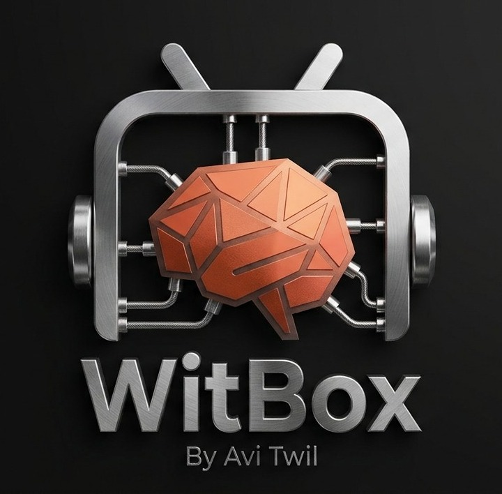
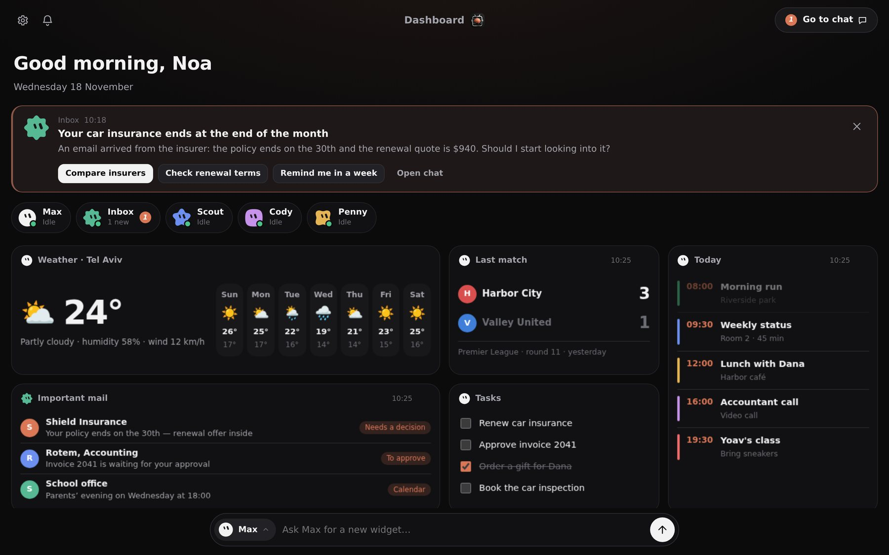
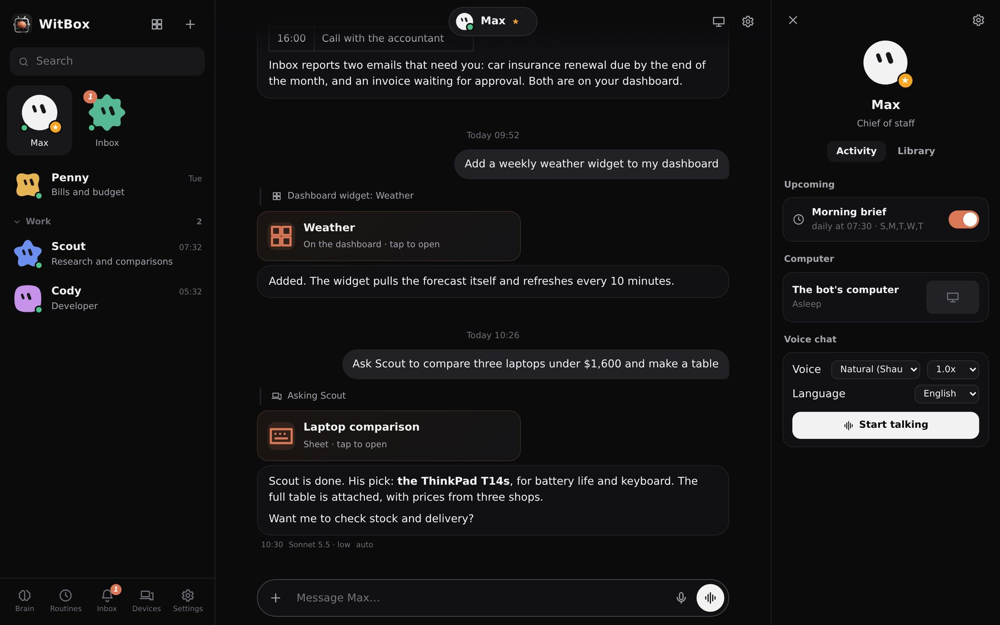
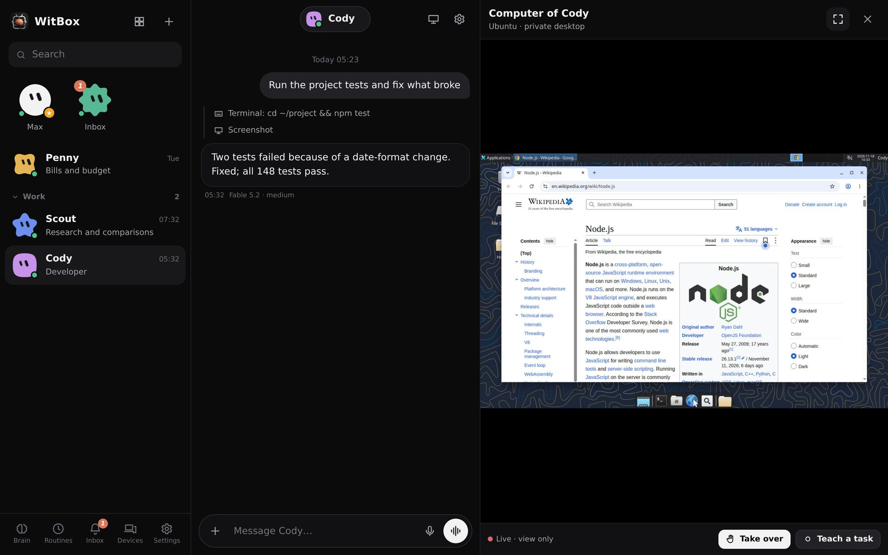
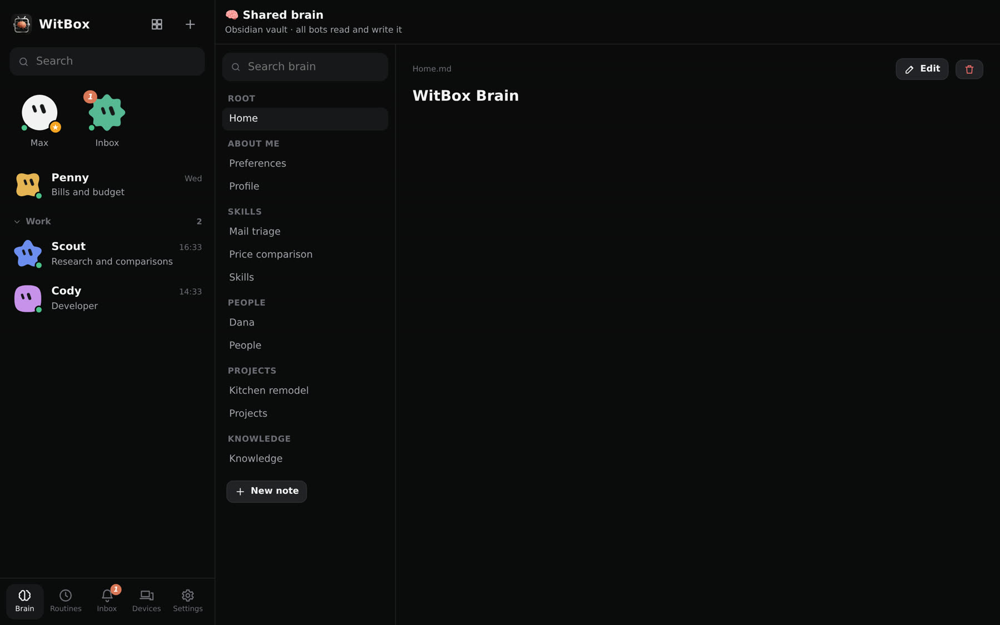
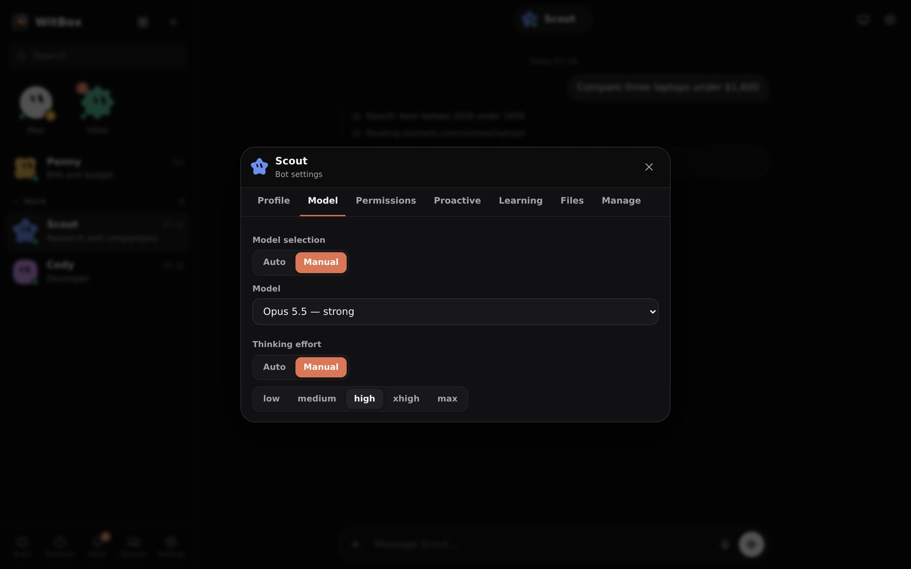
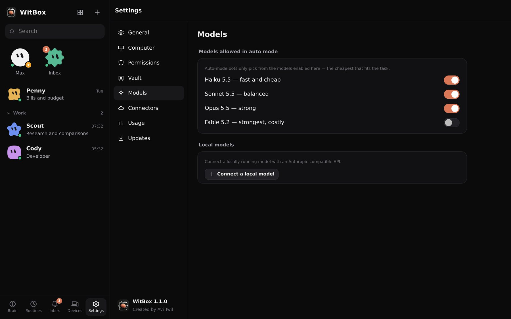
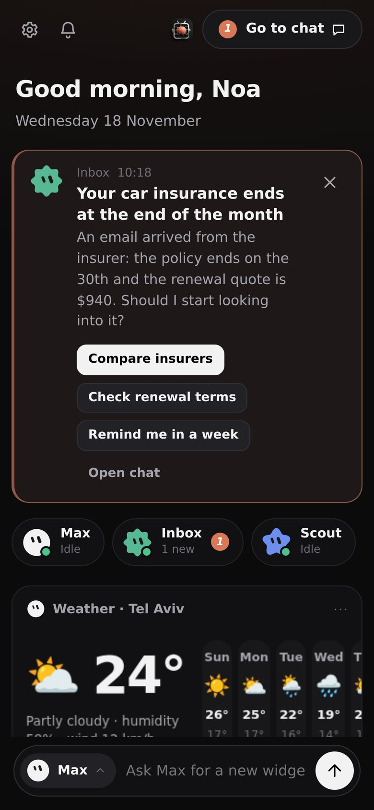
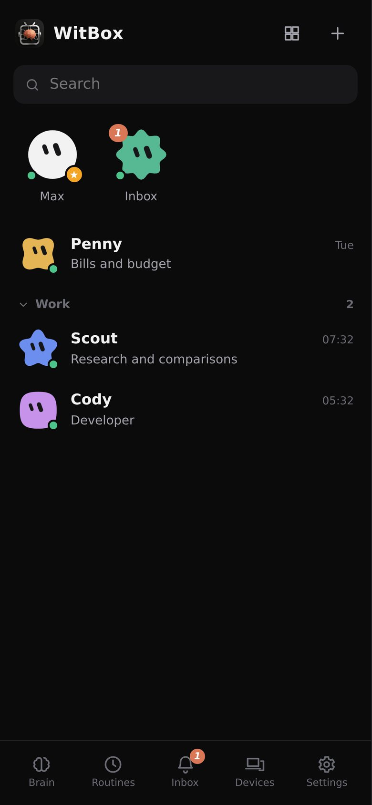
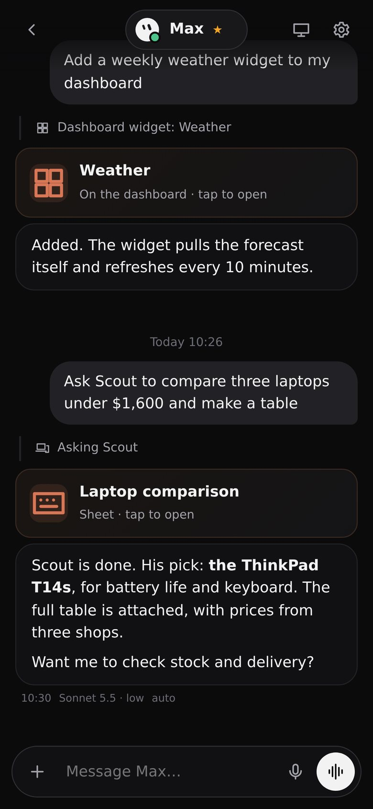

<p align="center">
  
</p>

<h1 align="center">WitBox</h1>
<p align="center"><b>Simple on the outside. Brilliant on the inside.</b></p>
<p align="center">
  The easy, friendly bot-team experience of Grok Bot — running on the power of Claude Code,<br>
  on your own machine, with your data staying with you.
</p>
<p align="center">
  <a href="https://witbox.avitwil.io">Website</a> ·
  <a href="https://witbox.avitwil.io/download.html">Download</a> ·
  <a href="README.he.md">עברית</a> ·
  <a href="mailto:witbox@avitwil.io">witbox@avitwil.io</a>
</p>

---



## What is WitBox?

There are AI tools with a chat interface so simple and pleasant that you just want to keep using them. And there is
Claude Code — one of the most capable agent engines available — which lives in a terminal.

**WitBox puts the first on top of the second.** It is a self-hosted home for a *team* of personal AI bots: you talk to
them like in a messaging app, they work on real computers, run on schedules, learn how you like things done, and show
you what matters on a dashboard. Under the hood every bot is a Claude Code agent (through the official Claude Agent
SDK), running on **your own Claude subscription** — no API keys, no extra billing.

- **Not another chatbot — a team.** A main bot that delegates, and specialists for mail, research, code, money… as many as you want.
- **Your server, your data.** Chats, files, memory and passwords stay on your machine. There is no WitBox cloud.
- **Private by design.** The server has no open port. It is reachable **only over your own [Tailscale](https://tailscale.com) network**.

> **WitBox is built to be installed on a Tailscale network.** Tailscale (free for personal use) connects your own
> devices into a private network. WitBox publishes itself only inside that network and only to *your* identity — it is
> never exposed to the internet. Every device you want to use WitBox from (phone, laptop) needs Tailscale installed and
> signed in to the same account.

## What you get

### A proactive team of bots
Bots don't just wait for a prompt. Give a bot a routine ("every morning at 7:30", "every 10 minutes", "when new mail
arrives") and it works in the background, notifies your phone when something matters, and puts **suggestions** on your
dashboard — *"Your car insurance ends this month. Compare insurers?"* — one tap starts the work.



### A personal computer for every bot
Every bot gets its own Linux user and its own desktop (Ubuntu + XFCE, with Chrome, Firefox, LibreOffice and a terminal)
inside a virtual machine on your server. Bots browse, click, type, run code and handle files like a person would — all
in parallel. You can watch any desktop live, **take over** the mouse and keyboard for a login or a CAPTCHA, or
**teach a task** by demonstrating it once.



### Continuous learning — the Brain
WitBox learns you the way Hermes Agent does: after conversations, a learning loop files what it found out —
your preferences, people, projects, corrections — into a shared **Brain**, and turns repeated work into reusable
**skills**. The Brain is a plain [Obsidian](https://obsidian.md)-compatible folder of Markdown notes on your disk: read
it, edit it, sync it. Every bot gets better the more you use the team.



### A dashboard your bots build for you
The app opens on a full-screen dashboard. Ask in plain words — *"add a weather widget"*, *"show my team's last
result"*, *"summarise today's important mail"* — and a bot builds the widget and keeps it up to date. Widgets are
small live apps; suggestion cards turn what the bots noticed into one-tap actions.

### The right model for every bot — or automatic
Pin a model and thinking effort to each bot (a fast one for mail triage, the strongest for code), or leave it on
**Auto**: WitBox picks the cheapest model that is good enough for each task, from the list you allow. Local models with
an Anthropic-compatible API can be connected too.

<p>
  
  
</p>

### One server, every device
The brain of the system runs on one machine. You reach it from native apps for **Android, Windows and Linux** (or any
browser on your tailnet). Start a task at your desk, follow it from your phone, and the team keeps working.

<p>
  
  
  
</p>

### And also
- **Voice chat** that answers like a phone call (with a natural, fully local Hebrew voice as an option).
- **Connectors** — Gmail, Calendar, Drive and everything else connected to your Claude account, available to the bots.
- **Permissions you control** — per connector: no access / read only / read, write and delete; per device: always / ask me / never; plus plain-language rules. One approval card per task, in plain words (who sent the email and its subject — never ids or raw data).
- **Vault** — saved logins are encrypted on your server and typed for the bot; the model never sees a password.
- **Artifacts** — boards, sheets, documents and diagrams open in a panel next to the chat.
- **Device control** — optionally let a bot operate the phone or PC you are holding; approved on that device only.
- **Phone tools (Android, full edition)** — SMS, calls, contacts, calendar, location and incoming messages of any app as text instead of screenshots; one switch per tool on the phone, verification codes hidden, and every outgoing SMS, call or reply is approved in a chat card first.
- Hebrew and English interface, light and dark themes.

## How WitBox compares

| | **WitBox** | Grok Bot | Hermes Agent | OpenClaw | Claude Code alone |
|---|---|---|---|---|---|
| Where your data lives | **Your own machine** | The vendor's cloud | Your machine | Your machine | Your machine |
| Interface | **Chat apps (Android / Windows / Linux / web) + dashboard** | Chat apps + dashboard | Terminal and messaging apps | Messaging apps | Terminal / IDE |
| Engine | **Claude Code (your Claude subscription)** | Grok | Many models (API keys) | Many models (API keys) | Claude Code |
| A team of named bots | **Yes, with a main bot that delegates** | Yes | Sub-agents | Multiple agents | Sub-agents |
| A computer for the bots | **Private VM on your server; own desktop and user per bot** | One cloud computer per account | Terminal back-ends | Your own machine | Your own machine |
| Continuous learning | **Yes — shared Brain + self-written skills** | — | Yes — built-in learning loop | File-based memory | Project memory files |
| Proactive routines and suggestions | **Yes** | Yes | Scheduler | Scheduler | — |
| Widget dashboard built by the bots | **Yes** | Yes | — | — | — |
| Model per bot / automatic routing | **Both** | — | Per configuration | Per configuration | Manual |
| Network exposure | **None — your tailnet only** | Public cloud service | You decide | You decide | Local |
| Price | **Free and open source** (+ your Claude plan) | Subscription | Free (+ model costs) | Free (+ model costs) | Claude plan |

<sub>Based on each product's public documentation in November 2026; products change, so check their sites. "—" means the
feature is not a headline capability of that product as far as its documentation shows. All product names are trademarks
of their owners. WitBox is an independent project and is not affiliated with, endorsed by or sponsored by Anthropic, xAI,
Nous Research, OpenClaw or Tailscale.</sub>

## How it works

```
 your phone / laptop ──(Tailscale, HTTPS)──►  your server
   WitBox app or browser                       ├─ WitBox server (Node.js, private unix socket — no open port)
                                               │    └─ one Claude Code agent per bot (Claude Agent SDK, your subscription)
                                               ├─ shared computer: Ubuntu VM (QEMU/KVM), a desktop + Linux user per bot
                                               └─ data/: chats, files, the Brain (Markdown), encrypted vault
```

## Requirements

| | |
|---|---|
| Server | A 64-bit (x86_64) Linux machine with systemd that stays on: a home server, mini-PC, workstation or VPS. Debian / Ubuntu / Kali / Mint, Fedora, Arch / Manjaro and openSUSE are handled by the installer. |
| Memory / disk | 8 GB RAM minimum (16 GB+ recommended), about 15 GB of free disk. |
| The bots' computer | Needs hardware virtualization (`/dev/kvm`). Most cloud VPS plans don't offer it — WitBox then works without the shared computer. |
| Claude | A paid Claude plan (Pro, Max or Team) — you sign in during the installation. Your use must follow Anthropic's terms. |
| Network | A [Tailscale](https://tailscale.com) account (free), with **MagicDNS** and **HTTPS certificates** enabled in the admin console (DNS page). |

## Install on Linux

Download two files from the [latest release](https://github.com/avitwil/WitBox/releases/latest) into the same folder —
**`witbox-linux-x86_64.tar.gz`** (everything in one file: server, web UI and the apps) and **`install.sh`** — then:

```bash
chmod +x install.sh
./install.sh
```

Or in one line (the script downloads the package itself):

```bash
curl -fsSL https://github.com/avitwil/WitBox/releases/latest/download/install.sh -o install.sh && bash install.sh
```

Run it as your normal user; it asks for `sudo` when needed. The installer:

1. installs the system packages it needs (QEMU, Xvfb, FreeRDP, x11vnc, ffmpeg…) with your package manager;
2. asks for the interface language, your name, and how much memory to give the bots' computer;
3. unpacks WitBox to `/opt/witbox` with a private copy of Node.js and installs the server modules;
4. signs you in to Claude (opens a link) and to Tailscale (opens a link), installing Tailscale if missing;
5. creates the `witbox` services and publishes the server **to your tailnet only**;
6. builds the bots' shared computer from the official Ubuntu image (downloads ~600 MB, then 20–40 minutes).

At the end it prints your address, e.g. `https://my-server.my-tailnet.ts.net`. Open it from any device on your tailnet.

Useful options: `--lang he|en`, `--name NAME`, `--no-vm`, `--voice` / `--no-voice`, `--vm-ram GB`, `--vm-cpus N`,
`--dir DIR`, `--yes`, `--uninstall`. Run `./install.sh --help` for all of them.

After the installation, manage WitBox with the `witbox` command:

```
witbox status | start | stop | restart | logs | url | login | build-vm | update | uninstall
```

## Install on Windows

Download **`WitBox-Setup.exe`** from the [latest release](https://github.com/avitwil/WitBox/releases/latest).

- **The app** (default): installs the WitBox client for Windows. On first start, enter your server's address.
- **The server on this PC** (optional, *experimental*): tick *"WitBox server on this PC (WSL2)"*. The server is a Linux
  program, so the installer sets up WSL2 with Ubuntu 24.04 and runs the Linux installer inside it. Needs Windows 11
  (or Windows 10 22H2) with virtualization enabled; the bots' shared computer needs nested virtualization
  (Windows 11). This path has had far less testing than a native Linux server — a Linux machine is the recommended
  home for the server.

## The apps

The installed server serves the apps itself — open **Settings → Updates** in WitBox, or download from the release page:

| Device | File | Notes |
|---|---|---|
| Android | `WitBox.apk` | Allow installing from this source, open, enter the server address, allow notifications. |
| Android (full) | `WitBox-full.apk` | Adds device control through an accessibility service, and direct device tools: SMS, call log, dialling, contacts, calendar, location and the notifications of other apps (as text, no screenshots). Each tool is a switch on the device, off by default. Play Protect blocks such apps from the browser and Android restricts their permissions when sideloaded — install with `adb` (`apps/android/install-full.sh`). |
| Windows | `WitBox-Setup.exe` or the portable `WitBox-windows-x64.exe` | Lives in the system tray, shows notifications. |
| Linux | `witbox-linux-x86_64` | `chmod +x witbox-linux-x86_64 && ./witbox-linux-x86_64` (needs WebKitGTK 4.1). |
| Any browser | your server address | Works on every device signed in to your tailnet. |

Every device must have Tailscale installed and signed in to **your** account. On first start each app asks for the
server address that the installer printed.

## First steps

1. Open WitBox — it starts on the dashboard. Press **Go to chat**, then **+** to create your first bot: describe in
   plain words what it should do and WitBox drafts the name, role and instructions.
2. Right-click (or long-press) a bot → **Set as main bot**. The main bot handles everyday requests and delegates.
3. Connect your services at [claude.ai → Settings → Connectors](https://claude.ai/settings/connectors); they appear in WitBox automatically.
4. Ask for a widget: *"Put the weather for my city on the dashboard."*
5. Make a bot proactive in its settings and give it a routine.

A fuller guide (Hebrew) is in [docs/GUIDE.he.md](docs/GUIDE.he.md).

## Security model

- The server listens on a private unix socket (mode 600) — there is **no TCP port**. The only way in is
  `tailscale serve` (HTTPS inside your tailnet; Funnel is not enabled).
- Requests must carry the Tailscale identity of the owner (detected on first start, shown in Settings → General). Anyone else gets 403.
- Bots work on their own desktop with their own unprivileged Linux user. They cannot run commands on the host unless
  you switch that on for a specific bot. File tools are confined to the bot's workspace and the Brain.
- Connector *write* actions (send mail, delete…) ask for approval by default: one card per task, with "allow all for this action", "always allow" and "deny". Text in chat is never treated as approval.
- Bots cannot run commands on the server at all; every command runs on the bot's own computer.
- Each bot has one folder shared with its own desktop only — **User files** (what you upload in chat), **Projects** (code it builds) and **Claude Code sessions** (read-only there). On the server the bot may write only there, in the Brain and in its small notes; links planted in the shared folder cannot lead it to other files.
- Controlling one of your own devices is approved on that device.
- Vault passwords are encrypted at rest (AES-256-GCM) and are typed into the bot's desktop without ever being sent to the model.

AI agents make mistakes. Review what your bots do, keep approvals on for anything that matters, and read the
[terms of use](https://witbox.avitwil.io/terms.html).

## Build from source

```bash
git clone https://github.com/avitwil/WitBox && cd WitBox
apps/android/build.sh            # Android SDK + JDK 21
apps/desktop/build.sh            # Rust, mingw-w64, WebKitGTK dev packages
packaging/build-release.sh       # → dist/ (tarball, installers, apps)
./install.sh                     # installs straight from the source tree
```

Layout: `server/` (Node.js, no build step) · `web/` (vanilla ES modules) · `apps/` (Android, desktop, Windows
installer) · `vm/` (the bots' computer) · `tts/` (local voice worker) · `packaging/` · `site/` (the website).

## Uninstall

```bash
witbox uninstall        # asks before deleting your data
```

## Terms and disclaimer

WitBox is free, open-source software provided **"as is", without warranty of any kind**. It runs autonomous AI agents
that can browse, send messages, change files and operate accounts you connect. **You alone are responsible for how you
use it, for what your bots do, and for complying with the terms of the services you connect (including Anthropic's and
Tailscale's).** See the [full terms of use](https://witbox.avitwil.io/terms.html) and the [MIT licence](LICENSE).

The optional Hebrew voice uses the Phonikud and Piper "shaul" models, which are licensed for non-commercial use.

## Created by

**Avi Twil** · [witbox.avitwil.io](https://witbox.avitwil.io) · [witbox@avitwil.io](mailto:witbox@avitwil.io)
